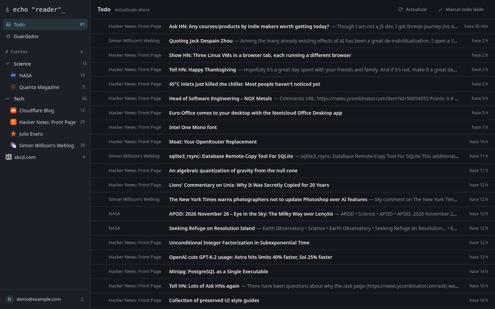
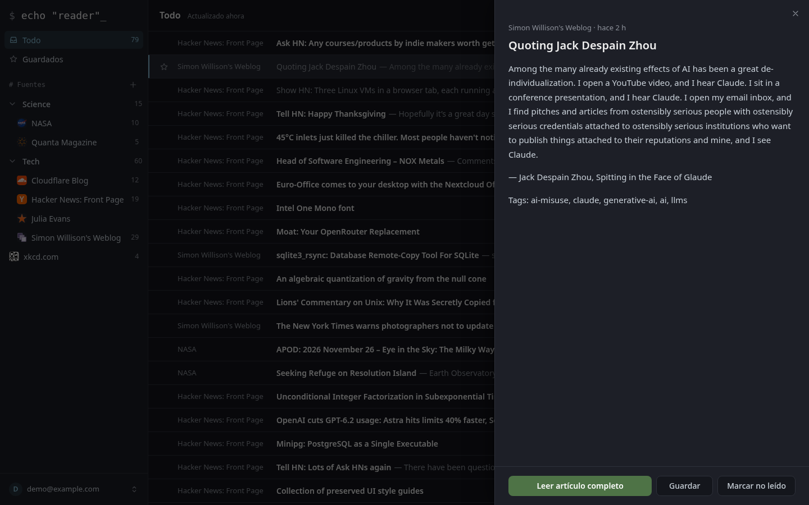
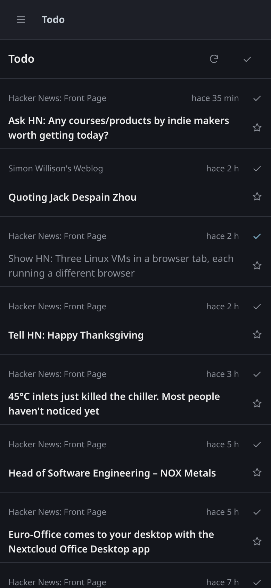

# RSS Reader

A simple, multi-user RSS reader. Each person creates an account, pastes the address of a blog (or its feed), and the articles start showing up and stay saved.

It runs on Cloudflare, usually within the free plan:
**Workers** (pages + API) · **D1** (SQLite) · **Cron Triggers** (refreshes every 15 min) · **Hono** + TypeScript.

## Screenshots

**Timeline:** one row per article, with sources grouped in folders in the sidebar.



**Preview:** clicking an article opens a panel with its summary.



**Mobile:**



## Features

- **Accounts:** sign up and log in with email and password.
- **`/admin` panel:** see users and who is online, kick, suspend or delete them, and open/close sign-ups (or set a user limit).
- **Add sources:** the **+** button next to "Fuentes" (choose Source or Folder, a modal opens) and a **+** on each folder to add a source directly into it. Paste the URL of a site or a feed; the feed is detected automatically.
- **Dense list** (one row per article) with the latest from all your sources: *All / Saved*.
- **Sidebar actions:** the `⋯` button on each source and folder (and on the header) opens a menu: mark as read, rename, move to folder, unfollow.
- **Favicons** in the sidebar: only the link is stored, not the image; if it fails, the initial is shown.
- **Folders** to group sources: create them with the **+** button next to "Fuentes", and delete them from their `⋯` menu without losing the sources.
- **Preview:** clicking an article opens a panel with its summary, so you can decide whether to read it in full. Ctrl/Cmd+click opens the original directly.
- **Save** articles with the star; **mark as read** when opening them (or manually).
- **OPML import / export** (with folders), to bring your feeds over from Feedly.
- Shortcuts: `j`/`k` move · `o` preview · `v` open original · `s` save · `m` read/unread · `/` add source.
- Dark theme with the colors, typography and terminal feel of [hernan941.com](https://hernan941.com/), no blinking animations, and a mobile-friendly layout.
- **Themes:** besides the default, Catppuccin Latte (light) and Mocha (dark); the choice is kept in a cookie.

The interface is in Spanish.

## Local development

```bash
npm install
npm run db:local     # creates the tables in the local database
npm run dev          # http://localhost:8787
npm test             # tests (parser, OPML, passwords)
npm run typecheck
```

## Deploying to Cloudflare

```bash
npx wrangler login
npx wrangler d1 create rss-dashboard      # copy the database_id into wrangler.jsonc
npm run db:remote                         # applies the migrations
npm run deploy
```

After this initial setup, every merge to `master` applies new migrations and deploys automatically through
GitHub Actions (`.github/workflows/deploy.yml`); there is no need to run `db:remote` or `deploy` by hand.

### Administrators

Access to `/admin` is granted by the `ADMIN_EMAILS` variable (comma-separated emails). Without it **nobody** is an
admin and the panel returns 404. It is set in the configuration on purpose, rather than "whoever signs up first",
so that nobody can get ahead of you on a public deployment.

```bash
npx wrangler secret put ADMIN_EMAILS      # e.g. you@example.com
```

Locally: copy `.dev.vars.example` to `.dev.vars`, put your email in it and restart `npm run dev`. The account must
exist (sign up first); the **Admin** link then appears at the bottom of the sidebar.

From the panel:

| Action | Effect |
|---|---|
| **Kick** | Ends all of their sessions. They can log in again. |
| **Suspend / Reactivate** | Ends their sessions and blocks login until reactivated. |
| **Delete** | Deletes the account and all its data (subscriptions, read state, saved items). Asks for confirmation. |
| **Close / open sign-ups** | Manual switch. |
| **User limit** | Sign-ups close automatically once it is reached (0 = no limit). |

Administrators cannot kick, suspend or delete each other from the panel. To remove someone as admin, take them
out of `ADMIN_EMAILS`.

### Invite-only sign-up (optional)

Besides the switch, you can require a code to sign up:

```bash
npx wrangler secret put INVITE_CODE
```

## How it works (and its limits)

- **Feeds are shared:** if 50 people follow the same blog, it is downloaded only once. Each person has their own
  subscriptions, names, folders, and read/saved state.
- **Cron:** every 15 min it checks the least recently updated feeds (only those with subscribers), in batches of 40
  to respect the free plan's outbound request limit. It uses `ETag`/`Last-Modified`.
- **Read state covers the last 14 days:** anything older counts as read (and does not add to the counters). This keeps queries cheap (D1 bills by rows read). Saved items do not expire.
- **Limit of 300 sources per user** (`MAX_FEEDS_PER_USER` in `src/db.ts`).

## Security

- Passwords with PBKDF2-SHA256 (100,000 iterations, the maximum Workers allows) and a per-user salt.
- Session in an `HttpOnly`, `SameSite=Lax` cookie (and `Secure` over HTTPS); only the token hash is stored in the database.
- Rate limiting: 8 failed logins per email / 40 per IP every 15 min; 5 sign-ups per IP per hour.
- Forms reject cross-origin requests (extra CSRF defense).
- **There is no email verification or password recovery** (no email service is configured).
  If someone forgets their password, it has to be changed by hand in the database.
- If the Workers free plan cuts off login because of the CPU limit (10 ms), the fix is the paid Workers plan
  (about 5 USD/month) or lowering `PBKDF2_ITERATIONS` in `src/auth.ts` (at the cost of security).

## Structure

```
src/index.tsx      routes (Hono), session and cron
src/auth.ts        passwords, sessions, rate limiting
src/admin.ts       instance settings and user management
src/db.ts          D1 queries (all scoped per user)
src/parse.ts       RSS / Atom / RDF -> entries
src/fetch.ts       conditional fetching and feed discovery
src/refresh.ts     batched refresh
src/opml.ts        import / export
src/views/         pages (server-side JSX)
public/            app.css and app.js
migrations/        D1 schema
test/              tests (vitest)
docs/screenshots/  README images
```
